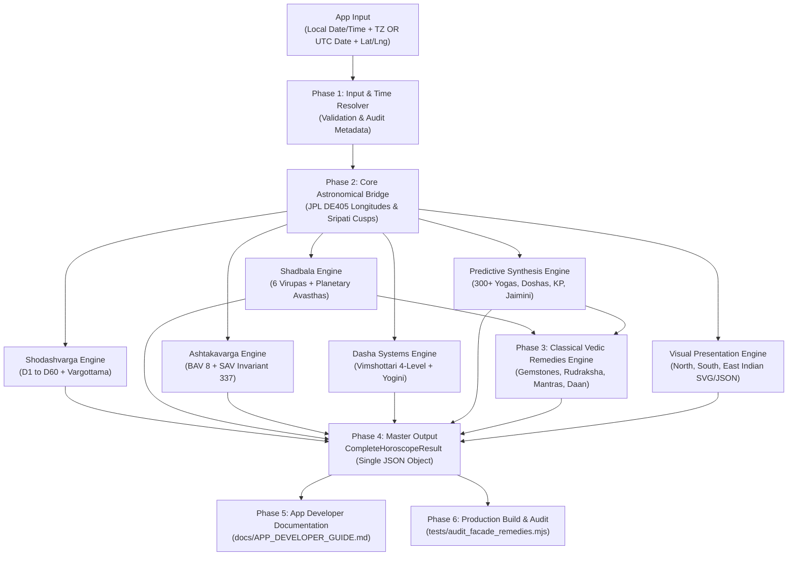

# Master Implementation Plan: Sanatan Astro Engine Plug-and-Play Facade & Vedic Remedies

**Target Repository:** `Sanatan_Watch_AstroEngine` (`https://github.com/vinayaksaxena1-maker/Sanatan_Watch_AstroEngine`)  
**Architecture:** 100% Clean-Room MIT/JPL Sanatan Engine (Zero GPL / Zero Swiss Ephemeris dependency)  
**Standard Execution Method:** Autonomous Agent Execution via `/goal`  

---

## 1. Executive Summary & Core Objectives

### Current Status
`Sanatan_Watch_AstroEngine` (Commit `fa48094`) successfully passed all 1,902 mathematical assertions across 50 horoscopes with an average latency of 7.27 ms. The 6 core modules (Kundli, Shodashvarga D1-D60, Shadbala, Ashtakavarga SAV 337, 4-Level Dashas, and 300+ Yogas/Doshas/KP/Jaimini/Tajik/Lal Kitab) are complete.

### The Problem This Plan Solves
1. **Fragmented Consumer Experience:** App developers currently have to make 8+ separate imports and pass shared data manually between modules.
2. **Timezone & Input Vulnerabilities (Identified by ChatGPT Guide):** The engine previously expected a pre-resolved UTC `Date` object without validating invalid coordinate bounds, causing crashes on bad input and forcing client apps to write fragile timezone conversion code.
3. **Missing Classical Remedies:** Astrological analysis calculates weaknesses (low Shadbala virupas, afflicted houses) but lacks an automated engine to prescribe classical gemstones, mantras, rudrakshas, and charity.
4. **House Ambiguity:** Sign-based house placement (Whole Sign) and cusp-based placement (Bhava Chalit) were not clearly distinguished in outputs.

### The Objective
Deliver a **Single Master Function (`calculateCompleteHoroscope`)** providing:
* One-line plug-and-play consumption for any app (Web, Vue, React, Capacitor, WearOS).
* Intelligent timezone resolution (accepting either UTC `Date` or `{ date, time, timezoneOffset, ianaTimezone }`).
* Bulletproof input validation guardrails.
* Classical Vedic Remedies (Gemstones, Rudraksha, Mantras, Charity per BPHS & Lal Kitab).
* Clear dual-house classification (`rashiHouse` vs `bhavaChalitHouse`).
* Official `docs/APP_DEVELOPER_GUIDE.md` for seamless frontend handoff.

---

## 2. High-Level Architecture Flow



---

## 3. Sub-Module Execution Specifications

### Phase 1: Input & Time Resolver (`src/facade/inputResolver.ts`)

#### Features:
1. **Dual-Format Input Support:**
   ```typescript
   export interface HoroscopeInput {
     // Format A: Direct unambiguous UTC instant
     birthDate?: Date;
     
     // Format B: Civil date + time + timezone
     date?: string;           // 'YYYY-MM-DD'
     time?: string;           // 'HH:mm:ss' or 'HH:mm'
     timezoneOffset?: number; // e.g. +5.5 for IST
     ianaTimezone?: string;   // e.g. 'Asia/Kolkata'

     // Geographic Coordinates (Mandatory)
     latitude: number;        // [-90.0, 90.0]
     longitude: number;       // [-180.0, 180.0]
     altitudeMeters?: number;

     // Calculation Preferences (Optional)
     houseSystem?: 'Sripati' | 'Placidus' | 'EqualHouse';
     ayanamshaSystem?: 'Lahiri' | 'KP' | 'Raman';
   }
   ```
2. **Validation Guardrails:**
   * Validate latitude: $-90 \le \text{lat} \le 90$; throw `InvalidCoordinateError` if violated.
   * Validate longitude: $-180 \le \text{lng} \le 180$; throw `InvalidCoordinateError` if violated.
   * Validate date: ensure timestamp is finite and within $[1800, 2100]$; throw `InvalidDateError` if violated.
3. **Audit & Provenance Metadata Block:**
   ```typescript
   export interface EngineMetadata {
     engineName: 'Sanatan Astro Engine';
     engineVersion: '1.1.0';
     calculatedAt: string;          // ISO UTC of calculation runtime
     resolvedUtcInstant: string;    // Exact birth instant in UTC
     julianDayUT: number;
     ayanamshaType: string;
     ayanamshaValue: number;
     houseSystemUsed: 'Sripati' | 'Placidus' | 'EqualHouse';
     coordinates: { lat: number; lng: number };
   }
   ```

---

### Phase 2: Dual House Placement (`src/facade/horoscopeFacade.ts`)

To eliminate the ambiguity raised in ChatGPT's guide, every planet entry will provide both:
* **`rashiHouse`:** (1 to 12) Position relative to the Lagna Sign (Whole Sign D1 Rashi chart).
* **`bhavaChalitHouse`:** (1 to 12) Exact house determined by Sripati/Placidus cusp boundaries (`Bhava Sandhi`).

---

### Phase 3: Classical Vedic Remedies Engine (`src/remedies/remedyEngine.ts`)

Built strictly upon the principles established in the `vedic-astronomy-math` skill:

#### 1. Gemstone Recommendation (रत्न परामर्श):
* **Life Stone (जीवन रत्न):** Ruled by Lagnesh (1st lord). Protects physical vitality, longevity, and overall constitution.
* **Lucky Stone (भाग्य रत्न):** Ruled by Bhagyesh (9th lord). Enhances fortune, spiritual growth, and prosperity.
* **Benefic Stone (पुण्य रत्न):** Ruled by Vidyapathi (5th lord). Enhances intellect, memory, and progeny.
* **Strict Maraka & Dusthana Prohibition (सख्त निषेध):**
  * Never recommend gemstones of Lords of 6th, 8th, or 12th houses (Dusthanas) or 2nd and 7th (Marakas), even if weak.
* Details generated per recommended gem:
  * Name (English & Hindi: Ruby/माणिक, Pearl/मोती, Yellow Sapphire/पुखराज, etc.)
  * Weight recommendation (carats / ratti based on body weight heuristic)
  * Metal (Gold, Silver, Panchadhatu, Copper)
  * Finger (Ring, Index, Little, Middle)
  * Day and auspicious planetary hour (Hora) for wearing.

#### 2. Rudraksha Recommendation (रुद्राक्ष परामर्श):
* Mukhi assignment (1-14 Mukhi) mapped to planets:
  * Sun $\to$ 1 / 12 Mukhi, Moon $\to$ 2 Mukhi, Mars $\to$ 3 Mukhi, Mercury $\to$ 4 Mukhi, Jupiter $\to$ 5 Mukhi, Venus $\to$ 6 Mukhi, Saturn $\to$ 7 / 14 Mukhi, Rahu $\to$ 8 Mukhi, Ketu $\to$ 9 Mukhi.
* Automatically targeted to the planet with the lowest Shadbala virupa ratio or severe combustion.

#### 3. Vedic Mantras & Japa Count:
* Vedic Beej Mantra, Gayatri variation, and prescribed classical japa repetitions (e.g., Jupiter: 19,000, Saturn: 23,000, Rahu: 18,000).

#### 4. Charity (दान) & Lal Kitab Upay:
* Remedial items, auspicious day, and target recipients for:
  * Active Shani Sade Sati or Dhaiya.
  * Mangal Dosha (when not cancelled).
  * Kaal Sarp Dosha & Pitra Dosha.

---

### Phase 4: Master Orchestrator Facade (`src/facade/horoscopeFacade.ts`)

#### Master Entry Point:
```typescript
export function calculateCompleteHoroscope(input: HoroscopeInput): CompleteHoroscopeResult;
```

#### Unified Output Structure:
```typescript
export interface CompleteHoroscopeResult {
  metadata: EngineMetadata;
  ascendant: {
    sign: string;
    signIndex: number;
    degree: number;
    formatted: string;
    nakshatra: string;
    pada: number;
  };
  planets: Array<ExtendedPlanetDetail>; // with rashiHouse & bhavaChalitHouse
  cusps: Array<HouseCuspDetail>;
  vargas: ShodashvargaResult;          // D1 through D60 + Vargottama
  shadbala: ShadbalaResult;            // 6-fold virupas + avasthas
  ashtakavarga: AshtakavargaResult;    // BAV 8 tables + SAV 337 sum
  dashas: {
    vimshottari: VimshottariTimeline;  // 4 levels: MD, AD, PD, SD
    yogini: YoginiTimeline;            // 36-year cycle
  };
  predictive: {
    yogas: YogaEvaluation[];           // 300+ Parashari yogas
    doshas: DoshaEvaluationResult;     // Manglik, Kaal Sarp, Sade Sati
    kp: KPChartResult;                 // 249 sub-lords
    jaimini: JaiminiResult;            // 7 Chara Karakas + Arudhas
    tajik: TajikResult;                // Varshphal solar return
    lalKitab: LalKitabResult;          // Masnooi planets & blind houses
  };
  remedies: VedicRemediesResult;       // Gemstones, Rudraksha, Mantras, Daan
  charts: {
    northIndianSvg: string;
    southIndianSvg: string;
    eastIndianSvg: string;
  };
}
```

---

### Phase 5: Official App Developer Guide (`docs/APP_DEVELOPER_GUIDE.md`)

Create comprehensive markdown documentation within the repository incorporating:
1. **Quickstart:** 3-line copy-paste code snippet showing how to calculate a full horoscope.
2. **Timezone Best Practices:** Explaining how to pass IANA zones vs explicit numeric offsets.
3. **Input Validation Checklist:** Guidelines for handling mobile geolocation and user time input.
4. **Data Dictionary:** Schema definitions for `CompleteHoroscopeResult`.
5. **UI Rendering Recipes:** How to render the SVG charts in Vue, React, or mobile WebView.

---

### Phase 6: Package Exports & Production Build

1. **Update `src/index.ts`:**
   ```typescript
   export * from './facade/inputResolver';
   export * from './facade/horoscopeFacade';
   export * from './remedies/remedyEngine';
   ```
2. **Execute Build:**
   * `npm run build:types` $\to$ Generate `dist/index.d.ts` declarations.
   * `npm run build:bundle` $\to$ Bundle ESM into `dist/index.js` via esbuild.
   * Confirm bundle size and ensure 0 TypeScript compilation errors.

---

### Phase 7: Comprehensive Unit Audit Suite (`tests/audit_facade_remedies.mjs`)

#### Test Gates (Zero-Failure SLA):
1. **Timezone Equivalence Gate:** Verify that inputting a UTC `Date` yields identical planetary degrees ($< 0.0001^\circ$) to inputting `{ date, time, timezoneOffset }`.
2. **Input Guardrail Gate:** Confirm that invalid coordinates (`lat: 95.0`) and invalid timestamps trigger expected TypeScript errors without unhandled exceptions.
3. **Remedy Safety Gate:** Ensure no horoscope receives gemstone recommendations for lords of 6th, 8th, or 12th houses.
4. **Invariant 337 Gate:** Confirm that `completeHoroscope.ashtakavarga.sarvashtakavarga` sum remains exactly **337** across all tested charts.
5. **Latency SLA Gate:** 10 consecutive full horoscope calculations executed; verify average execution time is $< 10\text{ ms}$.

---

## 4. Execution Step Checklist (For Agent)

- [ ] **Step 1:** Create `src/facade/inputResolver.ts` with time resolution, coordinate checks, and metadata builder.
- [ ] **Step 2:** Create `src/remedies/remedyEngine.ts` with gemstones, rudrakshas, mantras, and charity logic.
- [ ] **Step 3:** Create `src/facade/horoscopeFacade.ts` implementing `calculateCompleteHoroscope`.
- [ ] **Step 4:** Create `docs/APP_DEVELOPER_GUIDE.md` incorporating developer guidelines.
- [ ] **Step 5:** Update `src/index.ts` to export all new facade and remedy interfaces.
- [ ] **Step 6:** Create and execute `tests/audit_facade_remedies.mjs` verifying all 5 test gates pass (100% GREEN).
- [ ] **Step 7:** Run `npm run build` to verify clean bundle generation and type emissions.
- [ ] **Step 8:** Commit all changes with message: `feat: add plug-and-play complete horoscope facade, vedic remedies engine, and app developer guide` and push to `origin/main`.
