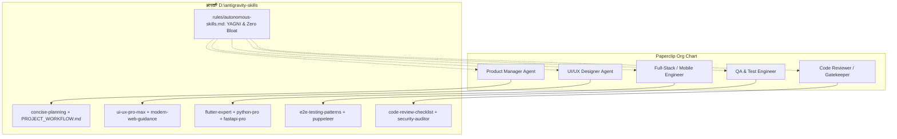

# 📎 Antigravity Skills & Paperclip Integration Architecture

> **मल्टी-एजेंट और स्किल्स का संपूर्ण एकीकरण गाइड (Integration Blueprint)**  
> यह दस्तावेज़ सुनिश्चित करता है कि आपकी सभी स्किल्स (`D:\antigravity-skills`) और Paperclip (`D:\paperclip`) बिना किसी ओवरलैप या टकराव के एक साथ पूरी शक्ति से काम करें।

---

## 🧭 1. सिस्टम की लेयर-वार संरचना (Layered Architecture)

| लेयर (Layer) | सिस्टम | क्या काम करेगा? (Responsibility) |
|---|---|---|
| **Layer 1: Management Plane** | **Paperclip (`D:\paperclip`)** | • **Who & When**: कौन-सा एजेंट कब काम करेगा? • **Org Chart & Roles**: CEO, Product Manager, Designer, Coder, QA. • **Budget & Tokens**: हर एजेंट का टोकन बजट और खर्च नियंत्रण। • **Approval Gates**: काम पूरा होने पर ह्यूमन बॉस (आप) से 1-क्लिक अप्रूवल लेना। |
| **Layer 2: Craftsmanship & Domain Skills** | **आपकी स्किल्स (`D:\antigravity-skills`)** | • **How & Quality**: कोड कैसा लिखा जाएगा? • `ui-ux-pro-max`: डीप ऑब्सिडियन, पवित्र केसरिया, 44px+ टच टार्गेट्स। • `modern-web-guidance`: ज़ीरो-ब्लोट, 60fps Native CSS एनिमेशन। • `flutter-expert`: डार्ट और मोबाइल आर्किटेक्चर। • `code-review-checklist`: सिक्योरिटी और क्वालिटी ऑडिट। |
| **Layer 3: Project Workspaces** | **आपके प्रोजेक्ट्स (`D:\Sanatan_Watch`, आदि)** | • वास्तविक कोडबेस, जहाँ एजेंट्स काम करेंगे। |

---

## 🎯 2. Paperclip रोल्स और आपकी Skills की मैपिंग (Role Mapping)

Paperclip में जब आप एजेंट्स की टीम बनाएंगे, तो उन्हें आपकी स्किल्स सीधे इस तरह असाइन होंगी:

---

## ⚠️ 3. क्या Skills और Paperclip आपस में Overlap करेंगी?

### संभावित ओवरलैप के 3 बिंदु और उनके पक्के समाधान (Risks & Solutions):

#### 🔴 जोखिम 1: Skill Definitions का टकराव (Duplicate Names)
- **समस्या**: Paperclip के अंदर भी `skills/` फोल्डर है (जैसे `paperclip-board`, `paperclip-create-agent`) और आपके पास भी `D:\antigravity-skills` है।
- **पक्का समाधान (Namespacing)**: 
  - Paperclip की आंतरिक स्किल्स केवल **`paperclip-*`** नाम से पहचानी जाएंगी जो सिर्फ बोर्ड, टास्क और मेल को संभालती हैं।
  - आपकी डोमेन स्किल्स (`ui-ux-pro-max`, `flutter-expert`, आदि) विशिष्ट नाम रखती हैं। दोनों के नाम में 0% ओवरलैप है।

#### 🔴 जोखिम 2: नियमों का टकराव (Rule Collisions)
- **समस्या**: Paperclip के अपने कोड के लिए कुछ नियम हैं (`rules/*.mdc`), जबकि आपकी परियोजनाओं (`Sanatan_Watch` आदि) के लिए कड़े नियम हैं (`rules/autonomous-skills.md` - YAGNI, Zero Dependency Bloat, No touching `src/`).
- **पक्का समाधान (Context Isolation)**:
  - Paperclip के आंतरिक नियम केवल `D:\paperclip` के अंदर सीमित रहेंगे।
  - जब कोई एजेंट आपके प्रोजेक्ट (जैसे `Sanatan_Watch` या भविष्य के प्रोजेक्ट्स) पर काम करेगा, तो वह **सख्ती से `D:\antigravity-skills\rules\autonomous-skills.md`** का ही पालन करेगा।

#### 🔴 जोखिम 3: टूल्स और डिपेंडेंसी का दोहराव (Tool Duplication)
- **समस्या**: क्या Paperclip अलग से टूल्स इंस्टॉल करेगा जिससे C: ड्राइव भरेगी?
- **पक्का समाधान**:
  - Paperclip सब कुछ `D:\paperclip` में ही रखेगा।
  - वह Antigravity के पहले से मौजूद CLI और MCP टूल्स (Puppeteer, Git, Terminal) का ही उपयोग करेगा। कोई दोहराव नहीं होगा।

---

## 🚀 4. वर्कफ़्लो में सहज एकीकरण (Smooth Daily Execution)

जब आप भविष्य में कोई भी काम शुरू करेंगे:
1. **Paperclip Board**: टास्क कार्ड बनेगा: *"Sanatan Watch: Poster Maker UI जोड़ो"*।
2. **Designer Agent Active**: यह एजेंट सीधे आपकी **`ui-ux-pro-max`** स्किल खोलकर डिज़ाइन स्पेक्स तैयार करेगा।
3. **Coder Agent Active**: यह एजेंट **`modern-web-guidance`** स्किल के अनुसार 60fps CSS कोड लिखेगा।
4. **QA Agent Active**: यह एजेंट **`puppeteer`** से स्क्रीनशॉट लेगा।
5. **Approval Gate**: Paperclip आपके सामने परिणाम पेश करके पूछेगा: *"Boss, सब टेस्ट पास हैं। Approve करें?"*

इस व्यवस्था से काम में कभी कोई भ्रम (Confusion) या ओवरलैप नहीं होगा!
